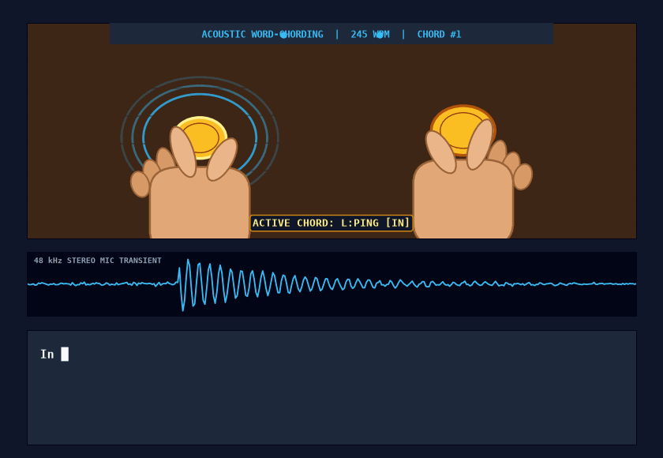

# CoinChord: Type at CharaChorder Speeds Using Everyday Desk Objects & Your Laptop Mic

# CoinChord: Type at CharaChorder Speeds with Two Desk Objects & Your Laptop Mic

Welcome to **CoinChord**—an acoustic word-chording keyboard that turns your laptop's built-in microphone and two everyday objects on your desk into a high-speed text input engine. No custom hardware, no webcams, no Bluetooth dongles, and zero batteries.

### The Core Mindset: Stop Spelling, Start Conducting
Most keyboards trap you in a 19th-century bottleneck: hunting down one letter at a time (`t` -> `h` -> `e` -> `space`). Radical chording keyboards like the **CharaChorder** break the 250+ WPM barrier by letting you trigger **entire words and phrases as a single physical gesture**.

CoinChord brings that exact philosophy to your existing laptop using **acoustic geometry**:
* **Think like a drummer or pianist, not a typist.** You aren't pressing tiny buttons; you are performing crisp **taps**, straight **lines**, sweeping **curves**, and circular **swirls** on your desk.
* **Your microphone is a 44,100 Hz radar.** While a webcam struggles at 30 frames per second in dim light, your laptop's mic captures 44,100 samples every second—easily separating your left hand from your right hand by resonant pitch, and telling a straight drag apart from a curved hook or a circular swirl.
* **Bind concepts to motion.** Never mentally spell out `"w-i-t-h"`. Instead, teach your hands that *"Left draws a line while Right hooks a curve"* simply **means** `"with "`. Once your motor cortex links the shape directly to the word, your hands flow at conversational speech speed.

---

## 1. What Objects Should You Use? (Coins & Everyday Alternatives)

CoinChord doesn't care what is in your hands—it only needs **two strikers that make noticeably different pitches** when they touch or slide across your desk:
* **Left Hand = High Pitch (~8.5–12 kHz):** Something small, light, or sharp that rings with a bright *"tink"*.
* **Right Hand = Low Pitch (~4.5–7.5 kHz):** Something larger, heavier, or denser that rings with a deeper *"clink"* or *"thunk"*.

### The Best Desk Pairs You Already Own

| Pair | Left Hand (High Pitch) | Right Hand (Low Pitch) | What It Feels Like |
| :--- | :--- | :--- | :--- |
| **Pocket Coins** | Small coin (e.g., \$1 MXN, Dime, €0.10) | Large coin (e.g., \$10 MXN, Quarter, €2) | **The Gold Standard.** Smooth edges glide effortlessly into circles and curves while ringing clearly. |
| **Key & Spoon** | House key (brass or steel) | Metal spoon or butter knife | **Maximum Contrast.** Almost impossible for the mic to confuse, even in a noisy café. |
| **Desk Pens** | Light plastic pen cap | Heavy metal pen or lighter | **Office Native.** Natural if you already fidget with pens while thinking or coding. |
| **Zero-Object** | Your bare fingernail | Wedding ring or knuckle | **Always With You.** Flick a fingernail for a sharp high click; tap a ring or knuckle for a low thud. |
| **Musician's Setup** | Guitar pick | Ceramic mug rim or wooden coaster | **Ultra-Fast.** Effortless high-speed taps and sweeps with zero hand tension. |

> **A Quick Note on Desk Surfaces:** Hard wood, laminate, glass, stone, or a thick hardcover book reflect crisp high-frequency sound straight into your laptop mic. If you use a soft cloth gaming mousemat, slide a hardcover notebook or wooden coaster under your hands so your strikers can sing.

## 2. How to Hold Your Strikers (Zero Arm Fatigue)

The fastest way to quit a new input method is shoulder soreness. Never hover your hands in mid-air like you're playing an invisible keyboard. Use the **Desk-Anchored Pinch**:

1. **Plant the heels of both palms flat on the table** right in front of your laptop. Your wrists stay relaxed and supported the entire time.
2. **Pinch each object lightly between your thumb and index finger**—just like holding a guitar pick—with about half of the object extending below your fingertips to touch the desk.
3. **Hold near the edge, never the dead center.** Squeezing the middle of a coin or spoon muffles its ring like grabbing a bell. Holding near the rim lets the metal vibrate freely.
4. **Keep gestures compact.** A **1-inch line** or a **dime-sized circle** gives the microphone more than enough acoustic detail. Small movements mean high speed and zero fatigue.

---

## 3. Quick Start

With Nix, run CoinChord from the project directory:

    $ nix run

Or enter the development shell and run it with Go:

    $ nix develop
    $ go run ./cmd/coinchord

On Linux CoinChord reads the mic through `arecord` from `alsa-utils`. On macOS it uses `rec` from `sox`. The flake provides both. CoinChord opens a full-screen terminal interface. You can click every control with the mouse, so you do not need to know any keys. The wheel scrolls lists.

The interface has six sections. The live strip at the top stays visible in all of them. It shows each striker as a coin that glows when the mic hears it, a loudness meter, the live sound spectrum, your last strokes and your last chord with the text it types.

## 4. Kits: Coins, Nails and Other Objects

A kit is the set of strikers you use. Each striker belongs to one hand. The **Overview** section shows the kits with their contrast, shape and speed ratings, and the number of gestures and chords each kit gives. Click a kit to use it.

The classic kits have one striker per hand, for example a small coin and a large coin. Larger kits have more voices per hand: two kitchen objects per hand, or each fingernail on the laptop palm rest (strikers `L1`–`L5` and `R1`–`R5`). More voices give more chords, but the voices must sound different. Calibration measures this for your objects, so you know if a kit works for you.

## 5. Calibrate

Open **Calibrate** first. It takes about two minutes:

1. Stay quiet for 2 seconds. CoinChord measures the room noise and sets the trigger.
2. Tap each striker 5 times. CoinChord learns the sound print of each one and shows how alike they sound. Alike strikers are easy to confuse.
3. Drag one striker 3 times. CoinChord learns the difference between a tap and friction.
4. Try every gesture 3 times. Each card shows a live score. Skip any gesture and come back later.

The report counts your reliable gestures, shows a score per shape and striker, and lists the weakest gestures with tips. The profile is saved in `~/.config/coinchord/profile.json` (the user config directory of your system).

## 6. The Gestures

A gesture is a source and a shape. The source is one striker, or two strikers of different hands at the same time (for example `L&R`). The shapes are:

* `TAP`: a light, quick tap.
* `KNOCK`: a firm tap, about twice as loud.
* `LINE`: a straight 1-inch drag.
* `CURV`: a drag that hooks at the end, like a J.
* `CIRC`: a small circle, 1.5 turns.
* `SLIDE`: a long, slow straight drag.
* `ZIG`: a fast zigzag scribble.

One gesture, or two gestures inside the chord window, make a chord. A two-coin kit has 21 gestures and 462 chords. The **Gestures** section shows every gesture of your kit with a drawing and a how-to. A card lights up when the mic hears it. The side panel shows how CoinChord measured the last stroke: duration, loudness, friction, bumps, pitch bend and which striker it matched, each against the knob that decides it.

## 7. Tutor

The **Tutor** starts by showing how one gesture types a whole phrase, and how a few gestures type a full sentence. Click *Watch the magic* to see it play. Then each lesson is one sentence of a short story. The tutor shows the next chord, how to perform it, and what it types. A wrong chord types nothing, so mistakes cost nothing. When the text has a word with no chord, the tutor switches to the `alpha` layer and spells it.

Each run measures words per minute, chords per minute, accuracy, time, and the chords you missed most. Your records are saved, and a progress chart shows your last runs. To practice your own text, put `.txt` files in `~/.config/coinchord/stories`, or start with:

    $ coinchord -text mytext.txt

## 8. Layers

A layer maps chords to text and keys. The built-in layers are `english` (common words and phrases), `alpha` (letters), `num`, `sym`, `kbd` (Return, Backspace, Tab, arrows, and shortcuts such as `ctrl+c`, `alt+tab` and `super+left` for window management), `spanish`, `python` and `go`. The `global` layer holds the layer switches. They work from any layer and use two-hand gestures. The **Layers** section shows every binding. Click a binding, or perform a chord, to type it into the sandbox.

## 9. Settings

**Knobs** change detection: trigger level, tap length, knock ratio, curve bend, slide length, circle and zigzag bumps, two-hand margin, chord window and more. Each knob has a safe range. **Bindings** edits layers: click *Record a new binding*, perform the chord, then write its expansion. An expansion is text plus tokens: `{enter}`, `{bs}`, `{tab}`, `{space}`, `{ctrl+alt+left}`, `{layer:kbd}`, `{undo}`, and `{{` for a literal `{`. You can add a new layer; CoinChord gives it a free switch chord. **Stories** reloads your texts and can give every missing word its own chord.

## 10. Troubleshooting

* **Noise or speech types words:** raise *Trigger level* in Settings, or calibrate again in a quiet moment.
* **Curves detected as lines:** hook the wrist more at the end, or lower *Curve drift Hz*.
* **Circles detected as lines:** make 1.5 turns, a bit wider, or lower *Circle bumps*.
* **Two strikers confused:** look at the report. If they are more than 90% alike, choose objects with more different sounds.
* **Test without a mic:** `coinchord -input file.raw` reads raw signed 16-bit mono 44100 Hz audio from a file.

Keyboard actions such as `{ctrl+c}` show in the sandbox. CoinChord does not yet send keys to other programs.
